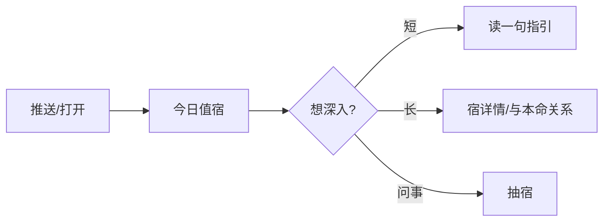

# 二十八星宿 Reading App — 第一批设计文档（研究 + 功能/UX）

> **状态**：第一批交付，供评审决策，尚未进入实现  
> **日期**：2026-08-10  
> **项目**：`/Users/yzhao/Workspace/28-xingxiu/`  
> **相关灵感**：README 提到文物「苏醒」出圈 → 星宿亦可做成有生命感的文化体验，而非传统算命站

---

## 1. Research summary：二十八星宿

### 1.1 它是什么

二十八宿（读 **xiù**，亦称二十八舍、二十八星）是中国古代天文学在黄道/天赤道附近划出的 **28 个恒星分区**。它首先是一套 **观测与历法坐标**：用「入宿度 + 去极度」记录日月五星、彗孛等位置，而不是现代意义上的「28 个性格星座」。

「宿」本义为止宿：月亮相对恒星约一夜移一宿，故有「月站」意象；但宿度并不等宽（如井、翼宽，觜极狭），说明它是长期观测与名号积累的结果，而非几何均分。

**关键考古/文献锚点：**

- 战国早期曾侯乙墓漆箱盖已出现完整二十八宿名（约前 5 世纪）
- 文献完整星名见于《吕氏春秋》等；《周礼》有「二十有八星」
- 河南濮阳西水坡等考古材料常被引作中国起源讨论的旁证
- 宋元以降大量进入通书、择日与星命；唐代《五星二十八宿神形图》赋予人形神格

### 1.2 结构：四象 × 七宿

| 四象 | 方位/季节意象 | 七宿（西→东序，自角起） | 禽星（七曜+动物）示例 |
|------|----------------|--------------------------|-------------------------|
| **东方青龙（苍龙）** | 东 / 春 | 角、亢、氐、房、心、尾、箕 | 角木蛟、亢金龙、氐土貉、房日兔、心月狐、尾火虎、箕水豹 |
| **北方玄武** | 北 / 冬 | 斗、牛、女、虚、危、室、壁 | 斗木獬、牛金牛、女土蝠、虚日鼠、危月燕、室火猪、壁水㺄 |
| **西方白虎** | 西 / 秋 | 奎、娄、胃、昴、毕、觜、参 | 奎木狼、娄金狗、胃土雉、昴日鸡、毕月乌、觜火猴、参水猿 |
| **南方朱雀** | 南 / 夏 | 井、鬼、柳、星、张、翼、轸 | 井木犴、鬼金羊、柳土獐、星日马、张月鹿、翼火蛇、轸水蚓 |

说明：

- **四象** = 天区 + 方位 + 季节 + 礼制意象的合称，不是单纯「星座图案」
- **禽星 / 星禽** = 宿 + 七曜（日月金木水火土）+ 动物形象，用于演禽命理
- 每宿另有「主事」民俗象征（如角宿主文昌、心宿主君王、鬼宿主凶事等）——属民间/通书层，需与天文坐标层分开呈现

### 1.3 传统用法分层（产品必须分清）

| 层级 | 内容 | 产品含义 |
|------|------|----------|
| **天文历法层** | 距星、宿度、分野、节候 | 可信文化底色；适合图鉴、星图、博物馆叙事 |
| **黄历值日层（宿直）** | 通书每日一宿轮值，28 日循环；与星期固定对应（28=7×4） | 天然「每日运势」钩子；**非实时天象**，是人为周期 |
| **本命/演禽层** | 按农历生日查本命宿；禽星论命、人际关系（业胎/安坏等） | 类似「本命星座」；注意存在 **27 宿系**（合牛入女，近宿曜）与 **28 宿系** 分歧 |
| **神格意象层** | 神形图、彩塑、灯会、戏曲小说中的人格化星宿 | 视觉与 IP 化最大空间（晋城玉皇庙彩塑、灯会四象区等已证明可出圈） |

### 1.4 vs 十二星座 vs 塔罗

| 维度 | 二十八星宿 | 十二星座 | 塔罗 |
|------|------------|----------|------|
| 坐标逻辑 | 月行/赤道带「月站」+ 距星计量 | 太阳黄道 12 宫 | 象征牌阵，非天体坐标 |
| 数量粒度 | 28（更细） | 12 | 78（大阿卡那+小阿卡那） |
| 日常入口 | **值日宿**（黄历）+ **本命宿** | 太阳星座 + 行运 | **抽牌**（随机/意图） |
| 用户心智 | 中国语境更熟「黄历宜忌」，少人会说「我是角宿」 | 社交身份极强（「我是天蝎」） | 问事仪式感强 |
| 确定性 | 偏「日期→宿」确定性系统 | 出生时刻→盘 | 同一问题可多次抽，强调当下 |
| 产品空白 | **几乎没有 Co-Star / Labyrinthos 级体验** | 极度红海 | 中英市场均成熟 |

**产品启示：** 不能只做「中国版十二星座」；应同时吃到：

1. 星座式 **身份认同**（本命宿）  
2. 黄历式 **每日节奏**（值日宿）  
3. 塔罗式 **问事仪式**（抽宿 / 三宿阵）  
并靠 **四象视觉 + 禽星人格 + 文化可信度** 做出差异。

### 1.5 现代用户可能期待什么

基于现有查询站与综合玄学 App 的内容形态，用户常见期待包括：

1. **我是哪一宿？**（生日 → 本命 + 禽星动物）  
2. **今日值哪一宿？宜做什么？**（值日 + 宜忌语气）  
3. **我和 TA 合不合？**（宿关系 / 配对）  
4. **这一宿什么性格 / 事业感情运？**（现代心理化解读）  
5. **图好看、能分享**（神形、四象、动物 IP）  
6. （小众）**真正天文**：今夜月亮入哪宿、距星在哪——教育向加分，非大众刚需

### 1.6 主要来源（本批查阅）

1. [维基百科：二十八宿](https://zh.wikipedia.org/wiki/%E4%BA%8C%E5%8D%81%E5%85%AB%E5%AE%BF)  
2. [百度百科：二十八星宿](https://baike.baidu.com/item/%E4%BA%8C%E5%8D%81%E5%85%AB%E6%98%9F%E5%AE%BF/675)  
3. [衍象坊：二十八宿详论](https://profound.fate-craft.com/baike/xingkong/zhanxing/ershiba-xiu)  
4. [LAMOST 相关：二十八宿的形成与演变](http://www.lamost.org/~yzhao/history/xiu28.html)  
5. [清华简《五纪》中的二十八宿初探（PDF）](https://www.ctwx.tsinghua.edu.cn/__local/4/C0/54/2A1C2CDD8FFFB14724AAE052B86_C1E50845_CF90C.pdf)  
6. [xingxiu.fengjun.wang：星宿查询与关系](https://xingxiu.fengjun.wang/)  
7. [jinengtisheng：28/27 宿系说明](https://jinengtisheng.com/apps/lunar-mansions/)  

---

## 2. Competitive / inspiration landscape

### 2.1 星宿相关（直接竞品 / 工具）

| 名称 | 平台 | 做什么 | 做得好的点 | 可借鉴 UX | URL |
|------|------|--------|------------|-----------|-----|
| 星宿关系查询站 | Web | 本命表、值日、关系配对、宿详情 | 结构完整（四象导航 + 查询表） | 「本命 vs 值日」双入口；四象分区浏览 | https://xingxiu.fengjun.wang/ |
| 技能提升网·星宿工具 | Web | 27 本命 + 28 值日双向推算 | 明确解释 27/28 体系差异 | Onboarding 必须讲清算法选择 | https://jinengtisheng.com/apps/lunar-mansions/ |
| 星座乐·28星宿查询 | Web | 生日查宿 + SEO 命理文 | 流量入口熟悉 | 避免其广告堆叠与廉价感 | https://www.1212.com/astro/xscx |
| 三藏起名网·28星宿 | Web | 算命字段大全 | 内容维度全（性格/事业/婚恋…） | 内容大纲可参考，呈现需重做 | https://www.sanzang5.com/28xingxiu.php |
| 演禽 App | Android | 演禽壬遁排盘、主客胜负 | 术数专业深度 | 专家模式可后置，不作 v0 主路径 | https://play.google.com/store/apps/details?id=com.kentang.yincome |
| 爱占星 | iOS/Android | 多体系排盘；含星宿关系 | 把「星宿关系」嵌进专业工具 | 关系维度可借鉴；整体过重 | https://apps.apple.com/cn/app/id1563231421 |
| 日本宿曜计算器 | Web | 27 宿本命、吉宿、相性、30 日历 | 单页算清、隐私本地算 | 「输入生日 → 一屏结果」效率 | https://www.senjutsu.jp/labo/shukuyo-calc |

**结论：** 星宿工具存在但 **体验落后一代**：多为表格站、黄历附庸或专业排盘。几乎没有「好看 + 每日习惯 + 轻仪式 + 可分享身份」的产品。这是机会窗口。

### 2.2 塔罗（仪式与学习）

| 名称 | 平台 | 借鉴点 |
|------|------|--------|
| [Labyrinthos](https://play.google.com/store/apps/details?id=com.labyrinthos.app) | App | 每日抽牌、牌义库、课程化学习、journal、「Mirror」聚合历史抽牌模式 |
| [Golden Thread Tarot](https://rakatarot.com/best-tarot-app-2026/) | App（legacy） | 极简美学；daily reading → 反思 prompt → 日记的闭环 |
| [Raka](https://rakatarot.com/) 等 2026 评测中的 AI 塔罗 | Web/App | AI 解读 + 本命上下文；注意本产品应避免「玄学黑盒」感，文化解释要可追溯 |

**可借 UX：** 抽牌仪式动画、牌义百科、三牌时间线阵、阅读日记、历史模式回顾。

### 2.3 西方星座 / 运势

| 名称 | 借鉴点 |
|------|--------|
| [Co–Star](https://www.costarastrology.com/) | 出生数据个性化；每日推送习惯；好友合盘社交；金句式短解读易分享 |
| [The Pattern](https://apps.apple.com/us/app/the-pattern-astrology/id1071085727) | 「模式/羁绊」叙事；关系而非单纯吉凶；音频/沉浸内容 |

**可借 UX：** 本命身份卡、今日一句、好友对比、分享图。

### 2.4 中式玄学 / 黄历

| 名称 | 借鉴点 |
|------|--------|
| [测测](https://play.google.com/store/apps/details?id=com.lingocc.cc5) | 每日运势习惯 + 塔罗/八字混搭 + AI 问答；注意其「大而全」与社区变现，我们应 **小而尖** |
| [元亨利贞排盘](https://www.china95.net/paipan/) | 工具齐全但 UI 工具化 |
| [玄易](https://www.ixybz.com/) | 专业排盘分层信息架构（基础盘 → 细盘） |
| [小南斗](https://apps.apple.com/cn/app/id1562331614) | AI 辅助解读盘面；万年历入口 |

**可借 UX：** 黄历「今日」信息密度控制；专业细节折叠；免责声明与「文化/自我觉察」定位。

### 2.5 灵感 takeaways（跨品类）

1. **双轨时间**：身份（本命）× 今日（值日/抽宿）——对应星座 App 的 chart × daily  
2. **仪式感 > 表格**：塔罗的抽牌动效值得迁移为「翻宿签 / 星宿苏醒」  
3. **关系是留存发动机**：合宿、好友对比（Co-Star Bonds）  
4. **学习层提高护城河**：图鉴 + 四象故事，对标 Labyrinthos，而非纯算命  
5. **现有星宿站的反面教材**：堆砌吉凶、广告、无视觉人格 → 我们做反差  
6. **文化苏醒叙事**（对齐 README）：神形/彩塑/博物馆文物式动效，可成为品牌记忆点

---

## 3. Product positioning options（头脑风暴）

### 方向 A —「每日值宿」黄历轻应用

- **一句话**：今天轮到哪一宿值班，给我一句宜忌与心情指引  
- **优点**：理解成本低；可接黄历习惯；实现快  
- **缺点**：易沦为万年历插件；差异化弱；难形成「我是××宿」身份  
- **适合**：工具型 MVP，不做品牌

### 方向 B —「本命星宿」中国版十二星座

- **一句话**：输入生日，遇见你的禽星与四象归属，做性格与配对  
- **优点**：社交传播强；内容模型清晰  
- **缺点**：算法争议（27 vs 28）；易被批「硬套西方星座」；每日打开理由不足  
- **适合**：内容社区冷启动

### 方向 C —「抽宿问事」塔罗化仪式（推荐底座之一）

- **一句话**：带着问题，请二十八宿显灵回应（单宿/三宿阵）  
- **优点**：仪式与娱乐性强；不依赖生日准确度；易做视觉高潮  
- **缺点**：与「宿直」传统不完全同源，需诚实标注「现代仪式玩法」；内容需大量牌义写作  
- **适合**：年轻用户、分享裂变

### ⭐ 推荐方向 D（综合，v0 主推）—「宿命图鉴 × 每日值宿 × 轻问事」

**定位一句话：**  
面向年轻用户的 **中国月站文化体验**：用四象与禽星建立身份，用值日建立每日习惯，用轻量抽宿提供塔罗级仪式——文化可信、视觉可出圈、不做「江湖算命站」。

| 对比 | 为何选 D |
|------|----------|
| vs A | 有身份与分享物，不只「今日宜忌」 |
| vs B | 每日钩子 + 仪式，不只静态性格文 |
| vs C | 仍锚定真实传统（值日/本命），抽宿是增强而非唯一 |

**品牌语气建议：** 文化觉察 / 诗性指引，而非绝对预言。界面文案可用「今日星象备忘」「与宿对话」，避免「必准」「改命」。

**视觉方向（呼应 README）：** 「星宿苏醒」——每一宿像文物/神形被点亮；四象为世界地图骨架；避免赛博紫、通用神秘风。

---

## 4. Feature set（v0 / prototype）

### 4.1 Must-have（原型必做）

| ID | 功能 | 说明 |
|----|------|------|
| M1 | **Onboarding：本命宿** | 公历生日 → 农历 → 本命宿（v0 先选定一种算法并透明标注）+ 四象 + 禽星 |
| M2 | **今日值宿** | 首页核心：今日宿、一句指引、宜/忌（温和语气）、与本命关系提示 |
| M3 | **28 宿图鉴** | 四象筛选；每宿：名称、禽星、方位、意象、现代解读、文化小注 |
| M4 | **轻问事抽宿** | 单宿抽 + 可选三宿阵（问境 / 阻碍 / 助言）；带翻牌/苏醒动画 |
| M5 | **身份分享卡** | 「我是心月狐 · 东方青龙」静态分享图 |
| M6 | **免责与分层标注** | 天文事实 / 黄历民俗 / 现代创作解读 三层标签 |

### 4.2 Nice-to-have（原型可示意，二期做深）

| ID | 功能 |
|----|------|
| N1 | 双人合宿 / 宿关系（业胎等需考证后谨慎呈现，或先做「四象相生相克」简化版） |
| N2 | 抽宿日记 + 历史「Mirror」（最常抽到的宿） |
| N3 | 「今夜天文」：示意月亮与黄道位置（教育彩蛋） |
| N4 | 四象主题音效 / 短叙事动画 |
| N5 | 好友对比（类 Co-Star，需账号） |
| N6 | 完整演禽/专业排盘 |
| N7 | AI 对话解读（有本命上下文） |

### 4.3 明确不做（本批 / v0）

- 付费大师连线、直播算命  
- 医疗/投资/婚姻绝对决策话术  
- 一上来做八字+紫微+奇门超级聚合（测测路径）  
- 假装抽宿结果等于真实天象

---

## 5. UX design

### 5.1 信息架构（IA）

```text
首页（今日）
├─ 今日值宿卡片
├─ 与本命关系一行提示
├─ CTA：抽一宿问事
└─ 次要：打开图鉴 / 我的宿命

问事
├─ 写意图（可选）
├─ 单宿 | 三宿阵
└─ 结果解读 + 存日记（可后置）

图鉴
├─ 四象 Tab（龙/虎/雀/武）
└─ 宿详情

我的
├─ 本命身份卡
├─ 算法说明（27/28）
└─ 设置 / 关于文化
```

### 5.2 核心用户流

#### Flow 1：首次获得「宿命身份」（对标星座 onboarding）


#### Flow 2：每日打开（对标 Co-Star daily）



#### Flow 3：问事抽宿（对标塔罗 daily draw）


### 5.3 关键屏幕（原型线框意图）

**Home — 今日**

```text
┌─────────────────────────────┐
│  今夜 · 房日兔 值日          │
│  ┌─────────────────────┐    │
│  │   [四象微缩 + 宿符]  │    │
│  │   「收敛心神，成事在细」│    │
│  └─────────────────────┘    │
│  与你的本命（心月狐）：相生   │
│  [ 抽一宿问事 ]  [ 图鉴 ]    │
└─────────────────────────────┘
```

**Reading result — 三宿阵**

```text
┌────────┐ ┌────────┐ ┌────────┐
│ 境     │ │ 阻     │ │ 助言   │
│ 氐土貉 │ │ 鬼金羊 │ │ 奎木狼 │
└────────┘ └────────┘ └────────┘
一段连贯解读（现代语言 + 可展开「古典意象」）
```

### 5.4 交互隐喻（选一为主，其它为辅）

| 隐喻 | 用法 | 建议 |
|------|------|------|
| **值日值班** | 首页 | 主隐喻：宿「轮值」如值日生 |
| **月站投宿** | 抽宿 | 主仪式：问题是旅人，宿是驿站应答 |
| **文物苏醒** | 图鉴/品牌 | 对齐 README：点亮宿像，而非抽鬼牌 |
| **星盘** | 本命 | 辅：简化「宿命卡」，不做复杂宫位 |

### 5.5 内容与算法原则（影响 UX 文案）

1. **v0 已确定采用中国黄历二十八宿：**  
   - 值日：采用中国传统黄历 **28 宿轮值**，保留牛宿  
   - 本命：以用户出生当日的黄历值宿作为原型中的「本命宿」，产品文案写明「按出生当日值宿」  
   - 不提供 27 宿切换，不采用「合牛入女」，不引入日本宿曜或其他衍生文化体系  
2. 第一版只用两层标签：`传统民俗` / `现代创作`；`天文知识` 层留到第二阶段  
3. 凶宿（如鬼宿）不做恐吓，改为「慎始、清理、边界」等自我觉察语言  
4. 禽星用字采用通行通书写法：**胃土雉**、**壁水貐**（历法库返回的 `彘`、`獝` 为异体，不作为展示依据）  

### 5.6 视觉与动效预算（设计原则，非实现）

- 品牌锚点：四象 + 禽星动物，而非通用神秘符号  
- 首屏：品牌名 + 今日一宿 + 一句指引 + 苏醒主视觉（单一构图）  
- 第一版动效聚焦 2 个：四象点亮、宿符翻转/苏醒；分享卡生成留到第二阶段  
- 回避：赛博紫渐变、通用塔罗桌布、信息仪表盘式首页  

---

## 6. 用户已确认的产品决策（2026-08-10）

以下决定是后续设计与实现的基础约束：

1. **主定位：** 采用方向 D——「宿命图鉴 × 每日值宿 × 轻问事」。  
2. **产品气质：** 年轻玄学娱乐，强调社交分享、仪式感与轻玩；文化来源仍需透明，不使用恐吓式断言。  
3. **文化边界：** 全部内容、算法和视觉叙事以中国传统为基础，不采用日本宿曜或其他衍生文化体系。  
4. **星宿体系：** 统一采用中国黄历 **28 宿**，保留牛宿；不支持 27 宿或「合牛入女」。  
5. **本命定义：** 原型将出生当日的黄历值宿称为用户的「本命宿」，界面必须附「按出生当日值宿」说明，避免与其他本命体系混淆。  
6. **抽宿定位：** 保留单宿问事，但明确标注为「现代互动玩法」，不声称是传统占法或实时天象。  
7. **交付形态：** 下一批直接制作可点击的 Web 前端原型，不制作 Figma 稿。  
8. **第一版范围：** 最小流程为 Onboarding 本命 → 今日值宿 → 抽一宿结果 → 图鉴列表/详情；允许使用原型级短文案。  
9. **第一版明确不做：** 三宿阵、分享卡导出、「我的」完整页、账号/后端、27 宿切换、其他术数聚合。  

### 尚未阻塞第一版的后续问题

- 正式产品名与品牌字标（原型暂用展示名「唤宿」，集中定义于一处常量，便于整体替换）  
- 上线前由历法/民俗顾问复核值宿算法和 28 宿文案  
- 第二阶段是否加入分享卡、抽宿日记和好友关系  

---

## 7. Work summary（本批）

### 已完成

- [x] 在线检索并综合二十八星宿：起源、四象结构、28 名与禽星、天文 vs 术数分层、与十二星座/塔罗差异  
- [x] 检索灵感产品：塔罗（Labyrinthos 等）、西方星座（Co-Star / The Pattern）、中式（测测、元亨利贞、玄易、小南斗）、星宿专项站与演禽/宿曜工具  
- [x] 头脑风暴 3+1 定位方向，给出推荐 D  
- [x] 输出 v0 功能优先级、IA、核心流、交互隐喻、待决问题  
- [x] 写入本文件供用户评审  

### 本批未做（明确边界）

- [ ] 高保真 UI / 前端实现 / 技术脚手架  
- [ ] 28 宿完整文案库与牌义  
- [ ] 农历/值日精确引擎实现与校验  
- [ ] 用户调研访谈、定量验证  
- [ ] AutoGLM 深度检索（本地 token 服务 `127.0.0.1:53699` 不可用，已改用 WebSearch/WebFetch）  

### 建议的下一步（待你确认后）

1. 按已确认范围搭建 React 可点击原型  
2. 实现 28 宿数据模型、黄历值宿推算和核心页面  
3. 完成自动化测试、生产构建与移动端流程验收  

---

## 8. Implementation status（2026-08-10）

最小可点击前端原型已落地于 `web/`：

- Onboarding → Today → Draw → Gallery/Detail 全流程可点
- 本命 / 今日均通过 `lunar-typescript` `getXiu()` 解析中国黄历二十八宿
- Vitest **28** 项通过；`oxlint` 与 production build 通过
- 变更摘要草稿：`PR-DRAFT.md`

---

*本文件为设计评审稿；文化叙述力求有来源，民俗吉凶层请以「传统观念」呈现，不作现实决策依据。*
